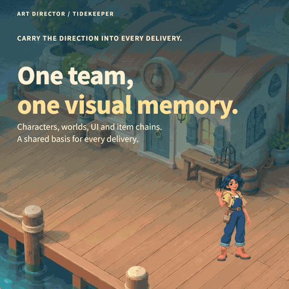
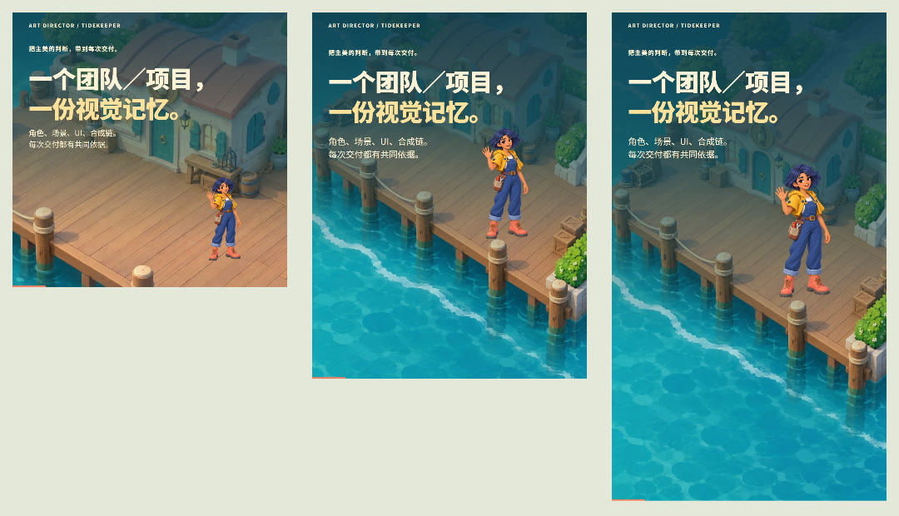

# eric-intro-motion-skill

Editable product and personal introduction videos. Reuse source artwork and render caches, then compose **every scene** for 1:1, 3:4 and 9:16. Chinese and English get their own typography, line breaks and card layouts.

[中文](README.zh-CN.md) · [Watch examples](https://newenergyeric.github.io/eric-intro-motion-skill/) · [Download v0.5.0](https://github.com/NewenergyEric/eric-intro-motion-skill/releases/tag/v0.5.0) · [MIT](LICENSE)

[](https://newenergyeric.github.io/eric-intro-motion-skill/tidekeeper/)

## Featured in v0.5: Tidekeeper

An illustrated harbor, a lampmaker, evolving objects, and a working merge-game UI. The new **Tidekeeper** case reuses the author's finished public artwork and rebuilds all six scenes in **Chinese and English × 1:1, 3:4 and 9:16**. Six complete 24-second films, source, assets, licenses, scene stills and encode checks are included. The gallery now opens with this case.

[Watch all six films](https://newenergyeric.github.io/eric-intro-motion-skill/tidekeeper/) · [Source and rebuild](examples/tidekeeper/README.md) · [Asset provenance](examples/tidekeeper/asset-provenance.json)



Choose the illustrated case for a product with rich artwork and UI. The small Pocket Notes recipe remains a simpler workflow starter; it is not the default visual style for every project.


## What's new in v0.4

- **A complete rename.** Repository, primary skill folder, metadata, display name, npm packages, installer and release assets use `eric-intro-motion-skill`. The old `motion-story` entry forwards old prompts and three CLI commands. `social-motion` remains the companion ratio utility. [Migration details](skills/eric-intro-motion-skill/references/migration.md).
- **Four reusable product shots.** Capture, tag, save and return form a small bilingual recipe. The new [Pocket Notes example](examples/native-intro/) includes six full 16-second MP4s, editable source, scene stills and encoded transition samples. It is original MIT artwork for a fictional workflow.
- **Every scene must reflow.** Audits compare matching scene frames from the same source revision, preserve text and layer identities, check glyphs inside UI containers, and reject a later scene that merely scales the master.
- **Resumable frames and audio edits.** SHA-256 checks recover missing or corrupt frames. Exact output hits skip rendering and encoding. Audio-only replacement verifies the video stream stays unchanged. No model API is called during rendering; no unmeasured token-savings claim is made.

These changes distill inspected production methods from the completed 68-second bilingual Anxiety Fixer introduction. Its branded footage/art and Dahao's private source stay local. [Evidence and licensing boundary](skills/eric-intro-motion-skill/references/case-findings.md).

## Install

Require **Node.js 22+** and **FFmpeg/FFprobe** on PATH. The vector renderer uses a bundled font; it needs no account, browser or paid rendering API.

```sh
git clone https://github.com/NewenergyEric/eric-intro-motion-skill.git
cd eric-intro-motion-skill
npm run setup
node scripts/install.mjs
```

The installer prints the exact `npm ci --prefix .../eric-intro-motion-skill` command for the installed runtime. Run it, then refresh skill discovery or start a new session.

For an existing installation, use `node scripts/install.mjs --upgrade`. Existing canonical, companion and legacy folders are preserved in a unique dated backup beside the skills directory. Without that flag, installation refuses to overwrite. Add `--dest /path/to/skills` for another skill library. The new [skill ZIP](https://github.com/NewenergyEric/eric-intro-motion-skill/releases/latest) also includes the canonical skill, companion and compatibility alias; run `npm ci` in the canonical folder after extraction.

> Use $eric-intro-motion-skill to introduce this product using its real workflow. Reuse its existing artwork, write natural Chinese and English, and recompose every shot for 1:1, 3:4 and 9:16. Deliver editable source and inspected videos.

## Render Tidekeeper

The illustrated case has its own locked React/Remotion dependencies and also requires Chrome. Its finished films can be watched without installing the renderer.

```sh
cd examples/tidekeeper
npm ci
node render.mjs --stills
node render.mjs
```

Inspect the stills before the full render. See [the case README](examples/tidekeeper/README.md) for output selection, Chrome configuration and export checks.

## Render the Pocket Notes workflow template

From the repository root:

```sh
npm run examples:intro -- --stills
npm run examples:intro
```

For a custom recipe, copy the [example JSON](skills/eric-intro-motion-skill/assets/examples/pocket-notes.json), edit its copy/timing, then run:

```sh
node skills/eric-intro-motion-skill/scripts/native-intro.mjs --input recipe.json --out output/intro --stills
node skills/eric-intro-motion-skill/scripts/native-intro.mjs --input recipe.json --out output/intro --cache output/frame-cache
```

Use `--languages zh,en`, `--ratios square,portrait,vertical`, or `--audio licensed-music.wav` as needed. The sample uses silent AAC. New outputs include posters, every scene's stable layout, measured audits, compressed entrance/hold/cut samples, output hashes and full-decode results. Exact cache hits skip rasterization and encoding. Changed existing outputs require `--force` or another directory. [Recipe, template limits and cache rules](skills/eric-intro-motion-skill/references/native-intro.md).

Only changing the soundtrack:

```sh
node skills/eric-intro-motion-skill/scripts/replace-audio.mjs --video old.mp4 --audio music.wav --out new.mp4
```

It preserves the source and compares video stream hashes. A new soundtrack must cover the whole timeline.

## Existing capabilities stay available

| Capability | Entry |
| --- | --- |
| Three vector story motifs, GIF/MP4/poster/SVG/JSON | `skills/eric-intro-motion-skill/scripts/cli.mjs` |
| Nine profile modules and three motion studies, clip caches | `skills/eric-intro-motion-skill/scripts/compose.mjs --list` |
| Cut/sequence existing media | `skills/eric-intro-motion-skill/scripts/assemble-media.mjs` |
| Social preset packs and native evidence audit | `skills/social-motion/` |
| Source-based React/Remotion example with original artwork | [Native Art Director](examples/native-art-director/) |

```sh
node skills/eric-intro-motion-skill/scripts/cli.mjs --input skills/eric-intro-motion-skill/assets/examples/idea-to-post.json --out output/demo
node skills/eric-intro-motion-skill/scripts/compose.mjs --input skills/eric-intro-motion-skill/assets/examples/profile-remix.json --out output/remix --preset xiaohongshu --cache output/clips
node skills/social-motion/scripts/pack.mjs --input skills/eric-intro-motion-skill/assets/examples/idea-to-post.json --out output/social --presets moments,xiaohongshu,vertical
```

`frame.mjs` and `reframe.mjs` still provide **explicitly requested** embedding or cropping treatments. They report `nativeReflow:false`; they are not a native multi-ratio conversion. [Whole-film native workflow](skills/social-motion/references/native-recomposition.md).

## Verification and examples

`npm test` covers bilingual layout, overflow and missing glyphs, unchanged legacy features, real MP4/GIF encoding, every-scene recomposition, corrupted-frame recovery, audio stream preservation and backup-safe migration. [Release verification](examples/native-intro/verification.json) records what was actually checked. Geometry and audit reports supplement visual review; social platforms may still crop thumbnails or add controls.

Open [the gallery](https://newenergyeric.github.io/eric-intro-motion-skill/) or `examples/index.html` after cloning. The downloadable examples ZIP includes renderers, recipes, source, fonts/licenses, MP4s and static alternatives. The optional Art Director case has its own locked React/Remotion dependencies. Rebuild old examples with `npm run examples` or `npm run examples:remix`; use `-- --force` when replacing their outputs.

Code, instructions and original vector artwork: **MIT**. Noto Sans SC and the Art Director font retain **OFL**. Private project assets are excluded. [Third-party notices and pinned sources](THIRD_PARTY_NOTICES.md).
