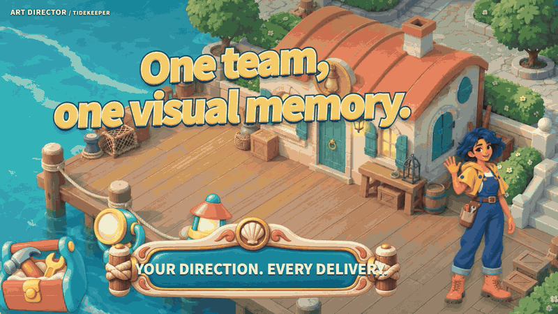
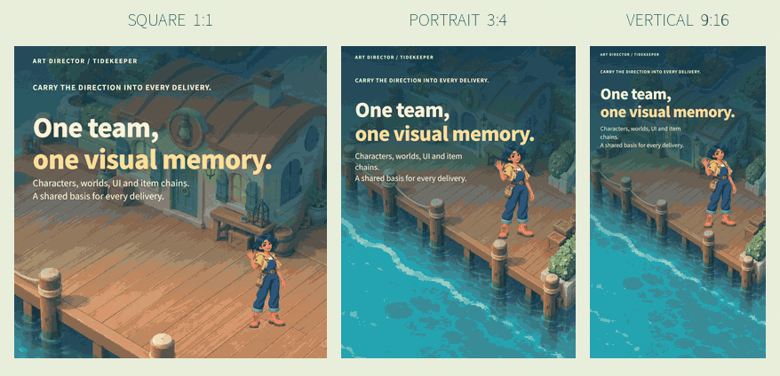

<p align="center"><sub><a href="README.md">English · 主介绍</a> · <b>中文说明</b></sub></p>

<h1 align="center">Eric Intro Motion</h1>

<p align="center"><em>把产品讲成一个看得见的故事。</em></p>

<p align="center">
  <a href="LICENSE"></a>
  <a href="#安装与升级"></a>
  <a href="#三种画幅同步看"></a>
  <a href="#三种画幅同步看"></a>
  <a href="#用在你的产品上"></a>
</p>

<p align="center"><strong>一个产品，三种原生构图，中英文分别呈现。</strong><br>
用已有美术和真实产品流程，做一支值得看完的介绍片。<br>
保留角色、细节和可编辑源码，让每种画幅都有自己的构图。</p>

<p align="center"><a href="#动态案例">看案例</a> · <a href="#三种画幅同步看">对比画幅</a> · <a href="#安装与升级">安装 Skill</a> · <a href="https://github.com/NewenergyEric/eric-intro-motion-skill/releases/tag/v0.5.3">下载 v0.5.3</a></p>

## 动态案例

**TIDEKEEPER · 潮灯小镇：修好灯房，点亮海港，迎接归航。**

最新英文影片把场景、角色、合成游戏界面和修缮过程连成完整的 24 秒故事。这里直接循环展示，仓库主介绍及主视频保持英语优先。

<picture>
  <source media="(prefers-reduced-motion: reduce)" srcset="examples/readme/hero-en.png">
  
</picture>

**[播放完整英语影片](https://newenergyeric.github.io/eric-intro-motion-skill/#cases)** · [下载 MP4](https://newenergyeric.github.io/eric-intro-motion-skill/materials-update/latest-source-en.mp4) · [静态封面](examples/readme/hero-en.png)

<sub>采用作者 Art Director 项目于 2026-10-13 已公开的最新英文原片。[来源、版本和许可](examples/materials-update/README.md)。</sub>

## 三种画幅同步看

**同一故事，每个镜头分别编排。** 三种画幅在一张动图中同步播放，可直接观察角色、标题和游戏界面的不同位置。

<picture>
  <source media="(prefers-reduced-motion: reduce)" srcset="examples/readme/three-formats-en.png">
  
</picture>

**[打开三画幅播放器](https://newenergyeric.github.io/eric-intro-motion-skill/)** · [中英文六支完整影片](https://newenergyeric.github.io/eric-intro-motion-skill/tidekeeper/) · [静态对比](examples/readme/three-formats-en.png)

<sub>三画幅使用较早的六幕剪辑；上面的最新英文原片属于后续版本。[可编辑案例](examples/tidekeeper/README.md) · [逐镜头检查](examples/tidekeeper/verification.json) · [动图测量](examples/readme/manifest.json)。</sub>

## 用在你的产品上

提供已经完成的美术、产品界面和故事，让 Skill 复用有效素材，为每个场景和画幅重新编排，并交付可修改的文件。

> 用 $eric-intro-motion-skill 介绍这个产品。复用我的美术，展示真实流程，中英文分别排版，为 1:1、3:4、9:16 逐镜头编排。在 GitHub README 内放英文循环预览和三画幅同步对比，交付源码、MP4、GIF 和静态封面。

有完整美术与 UI 时从[潮灯小镇](examples/tidekeeper/README.md)开始；简单的记录、分类、保存流程可参考[随手记](examples/native-intro/)。具体视觉风格跟随你的产品。

## 安装与升级

需要 Node.js 22+，以及 PATH 中的 FFmpeg / FFprobe。矢量渲染器自带字体，不需要账号、浏览器或付费模型 API。

```sh
git clone https://github.com/NewenergyEric/eric-intro-motion-skill.git
cd eric-intro-motion-skill
npm run setup
node scripts/install.mjs
```

安装器会打印已安装目录对应的 `npm ci --prefix .../eric-intro-motion-skill` 命令；执行后刷新 Skill 列表或开启新会话。

已有版本请执行 `node scripts/install.mjs --upgrade`。安装器先把原目录完整备份到 skills 旁的带日期目录，再安装新版；不带此参数不会覆盖。指定其他 Skill 库可加 `--dest /path/to/skills`。也可以解压 [Skill 发布包](https://github.com/NewenergyEric/eric-intro-motion-skill/releases/latest)，再进入新名称目录执行 `npm ci`。

安装后的名称为 **`eric-intro-motion-skill`**；同时包含 `social-motion` 画幅工具和 `motion-story` 兼容入口。[迁移说明](skills/eric-intro-motion-skill/references/migration.md)。

<details>
<summary><strong>重建影片与 README 动图</strong></summary>

## 渲染潮灯小镇

这个美术案例使用独立锁定的 React/Remotion 依赖，并需要 Chrome。直接观看成片无需安装渲染环境。

```sh
cd examples/tidekeeper
npm ci
node render.mjs --stills
node render.mjs
```

先检查静帧，再执行完整渲染。选择语言与画幅、配置 Chrome、导出并检查成片的用法见[案例说明](examples/tidekeeper/README.md)。

## 运行随手记流程模板

在仓库根目录执行：

```sh
npm run examples:intro -- --stills
npm run examples:intro
```

自定义时，先复制[配方 JSON](skills/eric-intro-motion-skill/assets/examples/pocket-notes.json)，修改文案和时长：

```sh
node skills/eric-intro-motion-skill/scripts/native-intro.mjs --input recipe.json --out output/intro --stills
node skills/eric-intro-motion-skill/scripts/native-intro.mjs --input recipe.json --out output/intro --cache output/frame-cache
```

可用 `--languages zh,en`、`--ratios square,portrait,vertical` 选择输出；`--audio music.wav` 添加许可明确且覆盖全片的声音。示例默认静音 AAC。精确缓存命中时不重渲、不重编码；内容变更后使用新目录或 `--force`。[模板范围、参数与缓存说明](skills/eric-intro-motion-skill/references/native-intro.md)。

只改音轨：

```sh
node skills/eric-intro-motion-skill/scripts/replace-audio.mjs --video old.mp4 --audio music.wav --out new.mp4
```

输出到新文件，原片保留，并检查视频码流和帧数未变。

### 重建 README 动图

```sh
npm run examples:readme -- --out output/readme
```

复用已完成的英语影片，导出两张完整 24 秒、20 FPS 循环 GIF、对应静态封面和哈希记录，并检查完整解码。[README 展示规范](skills/eric-intro-motion-skill/references/github-readme.md)。

</details>

## 已有功能继续保留

| 功能 | 入口 |
| --- | --- |
| 三类基础故事，导出 GIF / MP4 / 海报 / SVG / JSON | `skills/eric-intro-motion-skill/scripts/cli.mjs` |
| 九个个人介绍模块、三个动效研究、片段缓存 | `skills/eric-intro-motion-skill/scripts/compose.mjs --list` |
| 已有视频剪接 | `skills/eric-intro-motion-skill/scripts/assemble-media.mjs` |
| 社交比例预设、原生重排核验 | `skills/social-motion/` |
| 原创插画与 React/Remotion 源码案例 | [Native Art Director](examples/native-art-director/) |

```sh
node skills/eric-intro-motion-skill/scripts/cli.mjs --input skills/eric-intro-motion-skill/assets/examples/idea-to-post.json --out output/demo
node skills/eric-intro-motion-skill/scripts/compose.mjs --input skills/eric-intro-motion-skill/assets/examples/profile-remix.json --out output/remix --preset xiaohongshu --cache output/clips
node skills/social-motion/scripts/pack.mjs --input skills/eric-intro-motion-skill/assets/examples/idea-to-post.json --out output/social --presets moments,xiaohongshu,vertical
```

`frame.mjs` / `reframe.mjs` 只用于明确要求的嵌入、背景或裁切处理，并报告 `nativeReflow:false`。它们不能充当整片原生画幅适配。[完整工作流](skills/social-motion/references/native-recomposition.md)。

## 验证与交付

`npm test` 覆盖双语边界、缺字和溢出、原功能、真实 MP4/GIF 编码、逐镜头重排、缓存恢复、音轨无损替换与安装备份。[本次验证记录](examples/native-intro/verification.json)说明实际检查结果。程序测量配合画面检查；社交平台仍可能裁切封面或叠加控件。

[在线画廊](https://newenergyeric.github.io/eric-intro-motion-skill/)可直接播放和下载，也可在本地打开 `examples/index.html`。GitHub 源码压缩包包含完整渲染器、配方、字体许可、成片和静态替代图；Release 中较小的 ZIP 是便携 Skill 包。旧示例可用 `npm run examples` / `npm run examples:remix` 重建，需要替换输出时加 `-- --force`。可选 Art Director 案例使用其单独锁定的 React/Remotion 依赖。

代码、Skill 和原创矢量示例为 MIT；字体保留 OFL，私有项目素材不随包公开。[来源与许可](THIRD_PARTY_NOTICES.md)。

通用方法也吸收了 Anxiety Fixer 中英文六支 68 秒介绍视频的制作实践。其品牌素材和 Dahao 私有源码留在本地。[依据与边界](skills/eric-intro-motion-skill/references/case-findings.md)。
