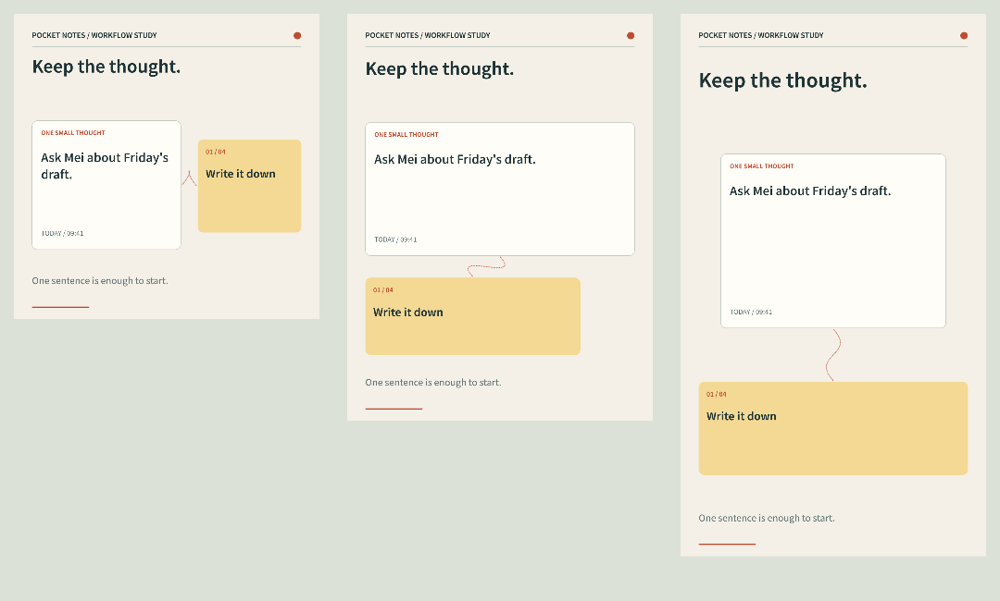

# eric-intro-motion-skill

用可编辑的镜头介绍产品、个人和具体想法。复用已有素材与渲染缓存，为 **1:1、3:4、9:16 的每个镜头原生重排**，分别调整标题、图片、卡片、文字换行和运动路径。中英文独立排版。

[English](README.md) · [在线浏览示例](https://newenergyeric.github.io/eric-intro-motion-skill/) · [下载 v0.4.0](https://github.com/NewenergyEric/eric-intro-motion-skill/releases/tag/v0.4.0) · [MIT 许可](LICENSE)



## v0.4 的实际更新

- 正式名称统一为 `eric-intro-motion-skill`，覆盖仓库、Skill 目录、元数据、展示名称、npm 包、安装入口和发布物。旧 `motion-story` 保留小型兼容入口；`social-motion` 继续作为画幅工具。[迁移说明](skills/eric-intro-motion-skill/references/migration.md)。
- 新增「记录—分类—保存—回来继续」四种可组合镜头。[随手记案例](examples/native-intro/)提供中英文各三种画幅，共六支 16 秒成片、源码、静帧和压缩后转场抽样。这是使用原创 MIT 矢量图形制作的虚构工作流示例。
- 校验逐镜头比对同一源码版本的文字和图层，检查文字是否超出卡片内部，拒绝只有部分镜头重排的假适配。
- 帧缓存按哈希校验，可补渲缺失、损坏的帧；成片精确命中时跳过渲染和编码。仅改声音时复制视频码流并核对哈希，避免二次压缩。

这些方法来自已核实的最新制作实践，包括 Anxiety Fixer 中英文六支 68 秒介绍视频。它的品牌素材与 Dahao 私有源码留在本地，公开仓库只吸收通用方法和许可明确的案例。[依据与边界](skills/eric-intro-motion-skill/references/case-findings.md)。

## 安装与升级

需要 Node.js 22+，以及 PATH 中的 FFmpeg / FFprobe。矢量渲染器自带字体，不需要账号、浏览器或付费模型 API。

```sh
git clone https://github.com/NewenergyEric/eric-intro-motion-skill.git
cd eric-intro-motion-skill
npm run setup
node scripts/install.mjs
```

安装器会打印已安装目录对应的 `npm ci --prefix .../eric-intro-motion-skill` 命令；执行后刷新 Skill 列表或开启新会话。

已有版本请执行 `node scripts/install.mjs --upgrade`。安装器先把原目录完整备份到 skills 旁的带日期目录，再安装新版；不带此参数不会覆盖。指定其他 Skill 库可加 `--dest /path/to/skills`。也可以解压 [Skill 发布包](https://github.com/NewenergyEric/eric-intro-motion-skill/releases/latest)，再进入新名称目录执行 `npm ci`。

> 用 $eric-intro-motion-skill 介绍这个产品的真实使用流程。复用已有素材，中英文文案自然具体，为 1:1、3:4、9:16 逐镜头重新编排，交付源码和检查过的完整视频。

## 运行新案例

```sh
npm run examples:intro -- --stills
npm run examples:intro
```

自定义时，先复制[配方 JSON](skills/eric-intro-motion-skill/assets/examples/pocket-notes.json)，修改文案和时长：

```sh
node skills/eric-intro-motion-skill/scripts/native-intro.mjs --input recipe.json --out output/intro --stills
node skills/eric-intro-motion-skill/scripts/native-intro.mjs --input recipe.json --out output/intro --cache output/frame-cache
```

可用 `--languages zh,en`、`--ratios square,portrait,vertical` 选择输出；`--audio music.wav` 添加许可明确且覆盖全片的声音。示例默认静音 AAC。精确缓存命中时不重渲、不重编码；内容变更后使用新目录或 `--force`。[模板范围、参数与缓存说明](skills/eric-intro-motion-skill/references/native-intro.md)。

只改音轨：

```sh
node skills/eric-intro-motion-skill/scripts/replace-audio.mjs --video old.mp4 --audio music.wav --out new.mp4
```

输出到新文件，原片保留，并检查视频码流和帧数未变。

## 已有功能继续保留

| 功能 | 入口 |
| --- | --- |
| 三类基础故事，导出 GIF / MP4 / 海报 / SVG / JSON | `skills/eric-intro-motion-skill/scripts/cli.mjs` |
| 九个个人介绍模块、三个动效研究、片段缓存 | `skills/eric-intro-motion-skill/scripts/compose.mjs --list` |
| 已有视频剪接 | `skills/eric-intro-motion-skill/scripts/assemble-media.mjs` |
| 社交比例预设、原生重排核验 | `skills/social-motion/` |
| 原创插画与 React/Remotion 源码案例 | [Native Art Director](examples/native-art-director/) |

```sh
node skills/eric-intro-motion-skill/scripts/cli.mjs --input skills/eric-intro-motion-skill/assets/examples/idea-to-post.json --out output/demo
node skills/eric-intro-motion-skill/scripts/compose.mjs --input skills/eric-intro-motion-skill/assets/examples/profile-remix.json --out output/remix --preset xiaohongshu --cache output/clips
node skills/social-motion/scripts/pack.mjs --input skills/eric-intro-motion-skill/assets/examples/idea-to-post.json --out output/social --presets moments,xiaohongshu,vertical
```

`frame.mjs` / `reframe.mjs` 只用于明确要求的嵌入、背景或裁切处理，并报告 `nativeReflow:false`。它们不能充当整片原生画幅适配。[完整工作流](skills/social-motion/references/native-recomposition.md)。

## 验证与交付

`npm test` 覆盖双语边界、缺字和溢出、原功能、真实 MP4/GIF 编码、逐镜头重排、缓存恢复、音轨无损替换与安装备份。[本次验证记录](examples/native-intro/verification.json)说明实际检查结果。程序测量配合画面检查；社交平台仍可能裁切封面或叠加控件。

[在线画廊](https://newenergyeric.github.io/eric-intro-motion-skill/)可直接播放和下载，也可在本地打开 `examples/index.html`。示例 ZIP 包含完整渲染器、源码、配方、字体许可、成片和静态替代图。旧示例可用 `npm run examples` / `npm run examples:remix` 重建，需要替换输出时加 `-- --force`。可选 Art Director 案例使用其单独锁定的 React/Remotion 依赖。

代码、Skill 和原创矢量示例为 MIT；字体保留 OFL，私有项目素材不随包公开。[来源与许可](THIRD_PARTY_NOTICES.md)。
