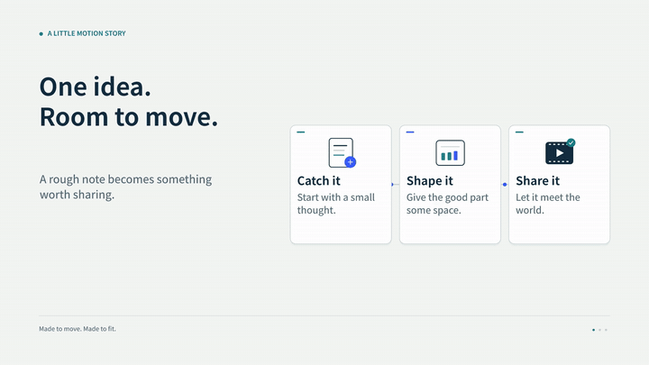
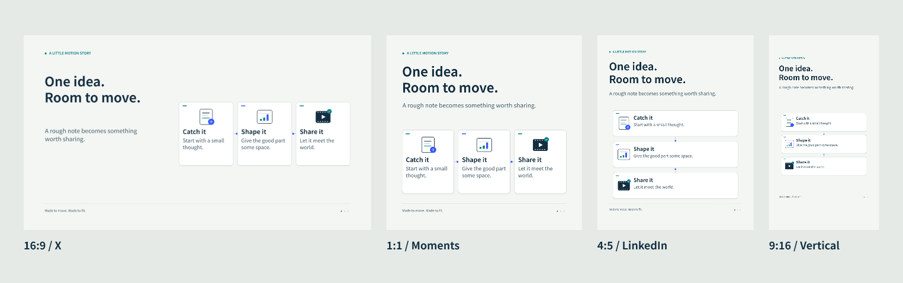

# Motion Story Skills

[English](README.md) · [下载](https://github.com/NewenergyEric/motion-story-skills/releases/latest) · [MIT 许可证](LICENSE)

把一个想法做成小动图，再让它适合你想发的地方。



起点很简单：做项目时，有些事情用几张会动的卡片、几条线，就比一大段话容易讲清楚。做完又发现，同一张图放进横版、方形、竖版，往往需要重新安排。

于是把制作和适配拆成了两个可以一起用的 skill。改文字、选画幅，就能得到 GIF、MP4 和静态封面；需要更特别的故事，也可以在这个基础上继续做。



## 两个 skill，各做一件事

| Skill | 做什么 |
| --- | --- |
| [`motion-story`](skills/motion-story/SKILL.md) | 把想法做成短小的矢量动效，交付 GIF、MP4、封面和可编辑内容。 |
| [`social-motion`](skills/social-motion/SKILL.md) | 在前者基础上，重排成 LinkedIn、X、朋友圈等画幅；也能处理只有成片的视频。 |

已有三种起步样式：信息沿着流程传递、围绕中心协作、整理视觉参考。它们是样例，可以继续扩展。自带英文、简体中文内容和字体，不依赖付费 API 或账号连接。

## v0.2：先复用，再创作

个人介绍里的九段动效现在可以拆开、换顺序、换文字，再按新画幅排版。另有错峰网格、路径追踪、滚动字带三种[参考研究](skills/motion-story/references/motion-studies.md)。只想重剪已有 GIF/MP4，也可以直接截取片段拼接，新增素材为零。

```sh
node skills/motion-story/scripts/compose.mjs --list
node skills/motion-story/scripts/compose.mjs --input skills/motion-story/assets/examples/profile-remix.json --out output/remix --preset xiaohongshu --cache output/cache
```

后续只改一份小 JSON：没改的片段复用缓存，整份配置没改就跳过渲染和编码。先用 `--formats png` 看排版。渲染本身不调用模型；构思和修改仍会消耗 token，不承诺未经测量的节省比例。[组合、剪辑和成片加框的用法](skills/motion-story/references/reuse.md)。

| 12 秒新样例 | 下载 |
| --- | --- |
| 个人介绍组件重新组合 · 1:1 | [MP4](examples/remix/profile-square/profile-remix.mp4) · [GIF](examples/remix/profile-square/profile-remix.gif) |
| 同一份组合 · 3:4 | [MP4](examples/remix/profile-portrait/profile-remix.mp4) · [GIF](examples/remix/profile-portrait/profile-remix.gif) |
| 三种动效研究 · 3:4 | [MP4](examples/remix/reference-portrait/reference-remix.mp4) · [GIF](examples/remix/reference-portrait/reference-remix.gif) |

朋友圈提供 1080×1080，小红书提供 1080×1440，也可选择 1080×1920。小红书 3:4 和朋友圈 1:1 是制作建议，发布时仍需检查手机预览。已有成片可以用 `social-motion/scripts/frame.mjs` 保留完整画面，在外面加标题、说明和同色背景。

## 先跑一份

准备 **Node.js 22+** 和 **FFmpeg**，确认命令行能找到 `ffmpeg`、`ffprobe`。

```sh
git clone https://github.com/NewenergyEric/motion-story-skills.git
cd motion-story-skills
npm run setup

node skills/motion-story/scripts/cli.mjs --input skills/motion-story/assets/examples/idea-to-post.json --out output/demo

node skills/social-motion/scripts/pack.mjs --input skills/motion-story/assets/examples/idea-to-post.json --out output/social --presets linkedin,x,moments,vertical
```

复制一份样例 JSON，换成自己的文字，再把它传给 `--input`。先加 `--formats png` 看排版，满意后再出动效。自定义尺寸、字体和导出选项见[内容格式说明](skills/motion-story/references/story-format.md)。

### 安装到 Codex

```sh
node scripts/install.mjs
```

它会把两个 skill 放进 `$CODEX_HOME/skills`，未配置时使用 `~/.codex/skills`，并打印一条准确的 `npm ci --prefix "…/motion-story"` 命令。执行这条命令安装运行依赖。若当前会话还没发现新 skill，刷新列表或开启新会话即可。

已有同名 skill 时，安装器会停下，避免覆盖。其他 agent 或项目目录可用 `--dest /path/to/skills` 指定；两个文件夹要放在一起。也可以下载 [Release 的 skill 压缩包](https://github.com/NewenergyEric/motion-story-skills/releases/latest)，解压后在 `motion-story` 中运行 `npm ci`。

可以直接这样说：

> 用 $motion-story 把“从一个想法到一个小作品”做成 8 秒动效。用我的文字，输出 GIF、MP4 和静态封面。

> 用 $social-motion 把这份内容适配到 LinkedIn、X 和朋友圈。每个画幅重新排版，保留全部文字，附上源文件。

## 已做好的样例

下面六份起步样例都是 8 秒循环，包含 MP4、GIF、PNG、源文件、设计安全区预览和检查报告。

| 样例 | 画幅 | 下载 |
| --- | --- | --- |
| 一个想法，从记录到分享 | 1920×1080，16:9 | [MP4](examples/idea-to-post/x/idea-to-post.mp4) · [GIF](examples/idea-to-post/x/idea-to-post.gif) |
| 同一份内容，LinkedIn 版 | 1080×1350，4:5 | [MP4](examples/idea-to-post/linkedin/idea-to-post.mp4) · [GIF](examples/idea-to-post/linkedin/idea-to-post.gif) |
| 同一份内容，方形版 | 1080×1080，1:1 | [MP4](examples/idea-to-post/moments/idea-to-post.mp4) · [GIF](examples/idea-to-post/moments/idea-to-post.gif) |
| 同一份内容，竖屏版 | 1080×1920，9:16 | [MP4](examples/idea-to-post/vertical/idea-to-post.mp4) · [GIF](examples/idea-to-post/vertical/idea-to-post.gif) |
| A little help. A better loop. | 1920×1080，16:9 | [MP4](examples/agents-at-work/x/agents-at-work.mp4) · [GIF](examples/agents-at-work/x/agents-at-work.gif) |
| 有些感觉，值得留住。 | 1080×1080，1:1 | [MP4](examples/keep-the-feeling/moments/keep-the-feeling.mp4) · [GIF](examples/keep-the-feeling/moments/keep-the-feeling.gif) |

下载仓库或样例压缩包后，用浏览器打开 [`examples/index.html`](examples/index.html)，可以切换画幅、查看安全区和播放视频。页面不会自动播放。重新生成用 `npm run examples`；替换现有样例时加 `-- --force`。

## 关于“不截断、没黑边”

有源文件时，标题、卡片和连线会按新画幅重新排。生成文件铺满画布，文字按实际字形测量，放不下就报出具体位置，不会悄悄截掉。

平台仍然会决定播放器、按钮覆盖和信息流缩略图怎样显示。LinkedIn 官方说明里明确提到设备差异和裁切；朋友圈方形版是保守的制作建议，需要在实际手机里预览。这里不会把广告规格当作个人朋友圈的规定。[平台依据和检查日期在这里。](skills/social-motion/references/platforms.md)

只有成片时，也有一个入口：

```sh
node skills/social-motion/scripts/reframe.mjs --input existing.mp4 --out square.mp4 --preset moments --mode backdrop
```

默认保留完整原画面，把周围空间用模糊背景填满。原片自带的黑边仍属于原片；横版小字放进竖屏也可能变小。这时最好回到源文件重做。也提供主动裁切模式，适合可以牺牲边缘的镜头。[处理方式说明](skills/social-motion/references/finished-footage.md)。

## 验证与开源

`npm test` 会检查中英文布局、内容完整性、循环运动、溢出报错，并实际编码一份 MP4 和 GIF。每次导出还会记录尺寸、时长、帧数、码率和文件校验值。原生动效 MP4 使用 H.264/yuv420p、方形像素、faststart、静音 AAC，视频目标码率为 1 Mbps。

代码、skill 和样例图形采用 **MIT**；内置 Noto Sans SC 字体保留 **SIL OFL 1.1**。[第三方声明](THIRD_PARTY_NOTICES.md)中列出了来源。不分发 FFmpeg 二进制。

欢迎一起补充新的动效、新的排版和有依据的平台适配经验。新样式请带上可编辑内容和实际检查过的样例。
